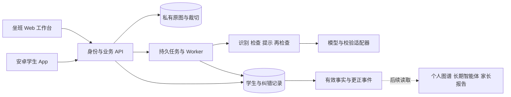

# 安卓平板纠错 App 一期实施框架

版本：v3.4，2026-10-16。面向产品、研发与托管现场负责人。用户已确认一期交付安卓平板 App；一期目标是帮助孩子检查自己的学校作业、完成订正并重新核实，同时留下可追溯数据。完整范围与质量门槛沿用 [PHASE1](PHASE1.md)，执行任务见 [一期 16 项任务](blueprint-v3/contracts/phase1-backlog.json)。

## 1 项目边界和首发范围

一期按一个可独立运行的产品交付：**学生安卓 App、坐班老师 Web 工作台、纠错后端、持久数据与运行保障**。当题 AI 提示直接服务纠错；个人知识图谱、长期智能体、家长报告、额外练习、预习和小测后续再建。

建议先覆盖一个托管点、一款主力安卓平板、一个年级的数学作业和明确可判断的题型。年级、科目、设备与人数是首轮范围建议，需按实际学生和模型测试冻结，不视为用户已经指定。首批优先评估题干完整、答案可核验的计算、选择、填空和简单代数；不同题型分别验收。复杂证明、开放作文、看不清或缺条件的题仍可保存和求助，但不能宣称自动支持。

一期成功应回答四个问题：孩子能否顺利检查并改正原作业；系统有没有误导孩子；坐班老师是否接得住；每条结论能否回到原图和处理过程。页面数、聊天次数、图谱覆盖和额外做题量不作为成功标准。

## 2 产品组成与用户旅程



日常路径：坐班人员确认设备上的孩子身份 → 孩子写完一页或一组学校作业 → 拍照并查看检查结果 → 自己根据提示订正 → 拍修改区域 → 再次检查 → 继续其他学校作业或休息。孩子卡住时在当前题求助，老师接手后仍回到同一条记录。无需先安排入门测验或录入完整教材图谱。

### 学生端六个主页面

| 页面 | 核心内容 | 验收重点 |
|---|---|---|
| 首页 | 当前孩子、拍作业检查、继续订正、历史作业 | 主按钮明确；工作人员授权切换身份；无后续模块空入口 |
| 拍照与预览 | 单页/多页、旋转、删页、必要裁切与补拍 | 原图保留；题干完整；模糊和反光可处理；不给孩子复杂标注任务 |
| 上传与检查进度 | 上传、识别、检查的真实阶段；允许离开页面 | 退出、断网、重开后可恢复；部分失败不伪装整页完成 |
| 整页结果 | 原图题区；需要订正、已确认正确、待核实、未作答、未识别范围 | AI 初判与已确认区分；不凭漏切后的题数计算整页正确率 |
| 单题订正 | 原作答、可核实错误位置、逐层提示、求助、拍订正、再检查 | 不默认展示整页答案；仍错、暂停和未解决均保留；点击完成不能通过 |
| 历史作业 | 按日期/科目查找，回看历次作答和帮助，继续订正、申请重查 | 正确题也保留；原图、修改过程和最新有效判断一致 |

等待老师、申诉和暂停放在相关页面中处理，不各做一个复杂模块。平板宽屏可采用原图与当前题并排布局，窄窗口顺序显示；旋转不丢状态。

### 坐班工作台

工作台包含待办队列、单题处理、学生作业历史及必要的学生/设备管理。待办分为孩子主动求助、识别/判断待核实、误判申诉，显示等待时间、接手人和当前状态。正在阻塞孩子继续作业的问题优先。

单题页同屏展示原图、题区、识别文本、模型依据、孩子看过的提示和历次订正。老师可以修正识别、确认或改判、保留无法判断、给予当前题帮助；操作记录身份与版本。未接单不能显示处理中，无把握不能强行确认。更换已归属照片的学生必须经过授权的异常处理并保留审计，不能随意拖到另一名孩子名下。

管理权限与答疑权限分开。学生建档、授权撤回、设备分配、支持范围、处理容量和运行告警放在同一个后台中按角色开放；普通坐班老师不接触供应商密钥或系统发布操作。

## 3 安卓与后端技术方案

| 层次 | 首选方案 | 选择理由与边界 |
|---|---|---|
| 安卓 App | Kotlin、Jetpack Compose、ViewModel、Repository | 一期只做安卓，直接管理相机、状态和设备生命周期；具体依赖版本由开工时冻结 |
| 相机 | CameraX 拍照、预览与图像质量辅助检查 | 保留原图与裁切坐标，不把设备相机差异交给业务代码到处处理 |
| 本地数据 | Room 保存待上传任务、页面状态与必要缓存；图片在应用私有文件区 | 本地排队可恢复；云端判定以服务端有效版本为准；Room 本身不等于加密方案 |
| 后台续传 | WorkManager 配合网络条件、退避与服务端幂等 | 用于可靠续传和同步；前台即时上传另外响应用户操作，不保证任何后台任务立即执行 |
| 坐班 Web | TypeScript 与团队熟悉的 React 或 Vue 组件栈 | 重点是原图对照与快速处理；首轮选定一种，不同时维护两套 |
| 后端 | Python/FastAPI 模块化单体，同一代码库运行 API 与独立 Worker | 便于接识别/模型和确定性规则；参考内核可借鉴领域规则，生产存储及身份需重新实现 |
| 数据 | PostgreSQL 与私有对象存储 | 关系、版本和任务入数据库；图片放受控存储，不作为大字段嵌入业务行 |
| 任务 | PostgreSQL 任务账本、租约、重试与事务 Outbox | 起步不增加消息集群；后续吞吐有证据需要时再引入队列服务 |

这是一套默认工程建议。若现有主力工程师已有可靠 Flutter 安卓相机、后台恢复与升级经验，可在开工短验证后沿用 Flutter；不能为切换技术栈牺牲交付。验收仍是同一套安卓真机行为。

Android 官方建议分离界面与数据层，并为系统销毁进程、旋转和网络中断保存状态；CameraX 支持预览、拍摄和图像分析，适合作为本项目相机基础。[架构指南](https://developer.android.com/topic/architecture)、[CameraX](https://developer.android.com/media/camera/camerax)

Room 用于本地结构化数据，WorkManager 支持持久后台任务和重试；这些组件不替代服务端任务状态、访问控制或即时响应设计。[Room](https://developer.android.com/training/data-storage/room)、[WorkManager](https://developer.android.com/develop/background-work/background-tasks/persistent)

具体平板需核对系统版本、相机对焦、横竖屏、内存、厂商后台限制和实际网络。ML Kit Document Scanner 通过 Google Play services 提供组件，不能在尚未验证该依赖的平板上直接当作默认扫描器；可先用 CameraX 和必要手动裁切完成采集。[Document Scanner](https://developers.google.com/ml-kit/vision/doc-scanner)

后端一期可部署 API 和 Worker 两个进程，使用同一代码版本，分别配置资源和重启策略。任务领取需有租约与过期回收，完成写入需幂等；数据库队列可使用行锁及 `SKIP LOCKED` 避免多个 Worker 同时领取，不能将该语义当作普通一致性查询保证。[FastAPI 部署](https://fastapi.tiangolo.com/deployment/concepts/)、[PostgreSQL SELECT](https://www.postgresql.org/docs/current/sql-select.html)

## 4 纠错引擎与确认规则

| 步骤 | 输入和输出 | 谁决定下一步 |
|---|---|---|
| 接收与质检 | 原图、页序、完整性 → 可处理范围或必要补拍 | 业务代码结合图像检测；看不清不判错 |
| 切题与识别 | 题干、孩子作答、过程分别识别并绑定原图区域 | 保留识别版本；人工可修订；未识别区域显式记录 |
| 求解与核验 | 识别题干 → 已审核答案/评分规则、计算或等价性校验、模型求解候选 | 校验真实来源与条件；模型生成的参考答案也是候选 |
| 逐题检查 | 学生作答与核验依据 → 正确/错误/部分正确/未作答/无法判断候选 | 不同合法解法应通过；有过程才定位具体错步 |
| 分层提示 | 当前有效判断、孩子已经用过的帮助 → 方向、必要关键一步或求助 | 业务服务约束提示层级和来源；不直接写掌握度 |
| 新订正 | 修改照片 + 原题版本 + 原作答关联 → 新作答 | 再次识别与核验，不能复用原题“已错”或一次点击作为结论 |
| 保存和反馈 | 当前核实结果、帮助条件、仍未解决事项 → 历史及后续事件 | 同事务保存事实与事件，界面读取最新有效版本 |

第一周用同一批已适当授权并按需脱敏的开发/校准作业样本比较两条技术路线：“专用 OCR/切题 + 模型核验”和“多模态直接结构化识别 + 校验”。按题型测误判、漏判、不可判断、错步定位、成本和时间，选择真实效果更好的主路线。只接少量候选服务比较，不把一期做成模型平台。最终供应商按效果、稳定性和数据处理安排冻结，不凭宣传基准选型。独立保留集不参与路线选择或提示词调参，在路线与阈值冻结后用于验收；验收失败需记录变更并保留新的独立验证范围。

校准阶段对小规模样本全量人工核实，分别统计 AI 初判和人工最终结果。正式使用中，疑难、冲突、申诉和学生求助必须有人工路径。若拟对特定题型开放自动确认，须先形成可复验的来源/规则、独立评测和版本回归，并实现对应确认来源与权限字段；模型自报置信度、两个模型意见一致都不直接构成放行条件。未满足时保留待核实或收缩范围，不能绕过当前确认规则。

## 5 数据模型与版本规则

一期主关联为：**学生 → 本次作业 → 照片/页 → 本次采集题目 → 纠错记录 → 多次作答 → 每次判断、提示和现场帮助**。完整题库、知识点图谱和长期智能体均不作为保存前提。

| 对象 | 必要内容 |
|---|---|
| 作业批次 HomeworkSession | 学生归属、科目、采集范围、页序、发生时间与记录时间 |
| 图片 ImageAsset | 私有原图、哈希、派生裁切、坐标变换与上传状态 |
| 采集题目 CapturedQuestionRevision | 采集生成的题目 ID、题干/题区、版本；题库 ID 和知识点可空 |
| 纠错记录 CorrectionCase | 根作答、当前有效作答、订正进度、仍未解决事项 |
| 作答 Attempt 与识别版本 | 每次真实提交分别保存；父/根作答关联、照片、答案/步骤、帮助条件；文本修订不伪造一次新作答 |
| 检查 CheckRun 与判断版本 | 输入版本指纹、模型/规则/提示词版本、候选结论、依据、核实来源、替代/撤销关系 |
| 提示 HintInteraction | 提示层级和内容、依赖判断版本、是否看过答案、展示时间及失效状态 |
| 现场处理 HelpRequest 与 Review | 求助类型、等待/接单/完成/未解决、处理者、原因与并发版本 |
| 任务与事件 Job 与 OutboxEvent | 幂等键、租约、重试、事务事件、消费位置和审计 |

同一图片哈希只用于辅助上传去重；一次实际重新作答即使答案相同，也可能需要新的 `attempt_id`。识别文本修改生成识别新版本，孩子重新拍订正生成新作答，两者不能混为一谈。

每个判断和提示保存具体输入版本。改题干或切题区域时，依赖旧版本的结果失效；只修正某次答案识别时，重判该次及确实依赖它的结果。旧 Worker 晚返回，若输入版本已过期，不得覆盖当前结果。老师撤销判断不删除孩子后来真实提交的照片，应重新核验其有效性。

状态分四类保存：任务执行（排队/运行/成功/可重试失败/失败）；判断有效性（候选/待核实/已确认/撤销/过期）；判断内容（对/错/部分正确/未作答/无法判断）；订正进度（待处理/修改中/再检查中/仍需订正/已核实解决/暂停）。漏切和未识别另记覆盖范围。任务成功不等于答对，提示后改对不等于独立掌握。

采用普通关系表、不覆盖的版本记录和事务事件即可。数据保留、授权撤回与删除同时覆盖图片、设备缓存和派生记录；后续图谱或报告按有效版本重建，不能重新使用已撤销或已删除的来源。

## 6 接口分组与工程目录

以下是一期接口边界建议，供 P1-01 冻结正式 OpenAPI；当前参考服务的 15 条路由不等于这些生产接口已经实现。

| 接口组 | 主要操作 | 强制约束 |
|---|---|---|
| 身份与设备 | 登录/刷新/退出、授权学生选择、设备绑定与撤回 | 服务端派生学生范围；短期设备凭据不能替代身份校验 |
| 作业和上传 | 创建作业批次、申请上传、确认上传、读取逐页进度 | 写操作幂等；完整性校验后才排检查；图片受控访问 |
| 题目和识别 | 原图对照、读取识别、提交修订 | 附 `expected_revision`，保留版本及失效关系 |
| 检查与提示 | 创建检查任务、读取结果、申请下一层提示 | 返回任务 ID，耗时工作异步；来源过期不能复用 |
| 订正 | 对当前题创建新作答、提交修改图、读取再检查 | 同学生、同一采集题目，绑定当前有效题目版本；版本更正后重核父/根关联，拒绝无源或成环 |
| 现场处理 | 求助、接单、复核、改判、无法判断、申诉 | 权限、版本与责任人必需；冲突返回可处理错误 |
| 历史与治理 | 查询本人作业/纠错过程、撤权、删除执行状态 | 所有读写按授权范围；删除过程可核实 |

异步操作返回受理状态和任务标识，App 可轮询并退避重连；不要把页面等待与后端长时间同步请求绑死。重复写入返回原业务结果；旧版本写入返回冲突；业务“无法判断”与服务“调用失败”分别表达。

建议在唯一生产代码仓库中组织如下目录，默认沿用已授权的 XueBan；这些是拟建目录，不表示工程已经创建。另一仓库的会议材料可以作需求来源，但不维护两套互相冲突的生产契约。

```text
apps/android/              安卓 App、相机、本地队列、页面与真机测试
apps/staff-web/            坐班与必要管理界面
services/backend/          API、Worker 与业务模块共用代码
  modules/identity/        身份、学生与设备授权
  modules/correction/      采集、识别、判断、提示、订正和复核
  modules/records/         历史、版本、更正事件与数据治理
  adapters/                模型、OCR、对象存储
contracts/phase1/          正式 OpenAPI、状态、事件、合成样例
evals/correction/          数据集索引、切片规则、结果与回归脚本
infra/                     环境、部署、迁移、监控、备份与恢复
docs/runbooks/             发布、回滚、坐班操作和异常处理
prototype/                 保留现有参考内核，标清非生产
```

首轮联调应有一条真实照片贯穿所有层的路径；团队各自写假数据页面不能算阶段交付。评测设计、样本收集和基线测量从第一周开始，P1-15 表示发布前完整验收，而非到最后才首次评测。

## 7 条件化排期与人员责任

以具备相关经验的安卓、后端、Web、AI/评测和 QA 各一人为估算基础，产品、设计与现场负责人持续参与，可由合适人员兼任部分职责。若团队只有一两名开发、没有可用题型或需要自研 OCR，必须重新估时。

| 时段 | 对外可验收的交付 | 对应一期任务 | 退出条件 |
|---|---|---|---|
| 第 1 周 | 支持范围、状态/接口/数据冻结；真机相机样机；同批样本的识别/检查对比结果 | P1-01/02/03/12，P1-15 的前置评测 | 确定设备、路线、测试集与阈值；首批支持题型有可核实答案和处理路径 |
| 第 2 周 | 可安装 App 拍真实作业，持久保存并显示逐题候选结果；坐班页可查看 | P1-04/05/06/09 | 原图、识别、结果可对照；部分失败和正确题均可呈现 |
| 第 3 周 | 提示、求助、订正再拍、再检查、历史与申诉串通 | P1-07/08/09/10/11 | C0 全流程通过；看得到原题、帮助和订正结果 |
| 第 4 周 | 断网/杀进程/升级恢复、隔离、删除、回滚、质量回归；小规模校准 | P1-13/14/15/16 | R1 达标后才进入受控试点；有现场接手容量 |
| 第 5—6 周 | 在真实出勤中使用、计量等待与人工负担、修复并回归 | P1-15/16 | 满足 R2；建议至少 10 个实际出勤日，未满足则延长 |

4 周是 C0/R1 候选目标，6 周是具备前提后的 R2 目标，不是保证交付日期。第 1 周若识别或判题路线不达标，立即缩小支持题型或重排，不把模型效果问题留到 UI 全部做完之后。

产品负责人管理范围和验收；技术负责人管理身份、数据、架构与发布；AI/评测负责人管理题型效果与模型回归；QA 验证正常/异常全流程；现场负责人确认真实工作量与孩子体验。最终放行要同时满足产品、技术和现场条件。

## 8 现场试点与运行指标

先用 3—5 名学生做短时校准并计量处理负荷，再按容量扩至一个班，建议 10—20 人。试点使用已有学校作业，不要求孩子额外做测评题。老师端应显示等待中的人数、最久等待、需核实题数和已接手事项。

容量按实际峰值计算：`所需净复核分钟 = 峰值提交题数 × 实测平均复核秒数 ÷ 60`。例如 20 名孩子各提交 20 题，假设每题 10 秒，全量复核需要约 67 分钟；若都集中在半小时内，至少相当于 2.2 人专做复核，尚未包括答疑。这是容量计算示例，不是模型或老师速度实测。超过排班时缩小并发/范围，或在通过验证与契约变更后开放明确题型的自动确认。

| 观察维度 | 需要记录的指标 |
|---|---|
| 纠错质量 | 正确题被判错率、错题漏检率、可判断覆盖率、漏切/未识别、错步定位、提示误导与再检查错误放行；每项附分子/分母和切片 |
| 完整过程 | 被确认需要订正的记录中，订正通过、仍错、待核实、暂停、离班分别计数；不剔除未完成者，也不催孩子补数据 |
| 实际体验 | 拍照成功/补拍、首次检查与再检查 p50/p95、网络等待、退出恢复、崩溃、老师响应时间 |
| 人工负担 | 每生复核与答疑耗时、峰值队列、未解决事项、兼任人员真实可用工时 |
| 数据可靠性 | 原图和版本可追溯、重复提交、串学生、撤销后旧结果复活、数据恢复和删除执行 |
| 单位服务成本 | 每次作业检查/订正的识别调用、模型用量、存储及现场处理时间；记录失败和重试成本 |

质量阈值、并发与时延、人工响应、保留期限、恢复目标在保留集评测和试点前冻结。模型准确率与人工修正后准确率分别报；没有结果的题不能从分母消失。样本不足、持续积压或严重误导须限制相关范围，不能以试点人数或日期到了自动放行。

## 9 安装发布与交接

一期优先交付组织可控渠道的签名安装包，安装方式结合目标平板和运营要求冻结。包名、签名密钥归项目方管理，依赖版本固定；密钥不入仓库，升级使用正确签名与数据迁移。Android 更新涉及签名一致性，应实际验证从旧版覆盖升级后账号、草稿和历史仍可用。[App 签名](https://developer.android.com/studio/publish/app-signing)

环境至少区分开发、验收和生产；普通开发使用合成/脱敏数据。交接包包括可安装 APK、后端/工作台部署产物、正式接口和迁移、配置模板、设备矩阵、评测报告、生产运行说明、备份恢复与回滚记录、坐班操作手册和已知支持范围。上线后能按任务 ID 找到失败阶段、模型版本和责任队列，告警中不附带完整学生作业或凭据。

## 10 开工前两天的具体产出

产品与现场负责人提供现有作业类型、代表性拍摄条件和坐班时段；技术负责人确定设备、人员和技术栈；AI/评测人员准备独立标注与数据集划分。先用合成或已适当授权的脱敏资料测试，再按实际数据安排进入试点。

两天内应看到：一份冻结的首发范围表、一台可拍照的安卓样机、同批样本的两条识别/检查路线结果、一套作业到订正的数据示例，以及按 16 项任务划分到人的里程碑。无法判断与错误结果也必须进入演示和评测，避免只展示成功样例。

本仓库当前仍处于产品与参考内核阶段；上述 App、服务目录、供应商接入和发布产物是待实现目标。Android 平台已确认，具体机型、年级/科目、人员和供应商仍按首轮范围冻结。
