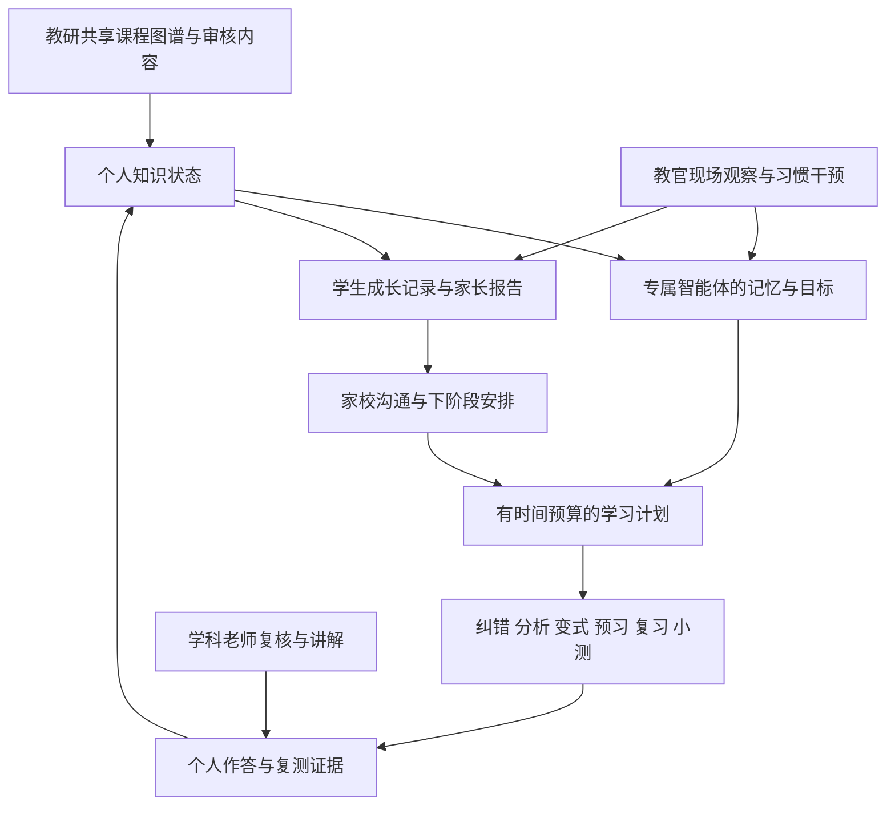

# 学伴产品总纲与开发入口

版本：v3，2026 年 10 月 16 日。产品定位与完整功能以本版为准。本文中的新能力是建设目标，完成状态以研发验收记录为准。

## 1 产品主张

**一人一张知识图谱，一人一位专属 AI 学伴，每一步成长都有依据。**

学伴面向线下学习校区，把孩子的学校任务、知识理解、解题方法、学习执行和复习表现持续连接起来。AI 学伴了解当前目标和历史，安排适合当下的学习动作；教官在场帮助孩子真正执行并纠正习惯；学科老师负责判断、讲解与教学质量；系统记录行动与结果，为下一次辅导提供依据。

产品要同时解决三类问题：学习内容需要因人调整，计划需要有人落实，进步需要独立验证。全方位支持的范围是知识、方法、任务执行、自我检查、复习保持和家校协作，不把学习记录扩写为人格或心理诊断。

## 2 每个孩子真正拥有的六项资产

| 个人资产 | 具体内容 | 学生或家长可感知的价值 |
|---|---|---|
| 个人知识图谱 | 当前已验证的知识、薄弱子范围、前置关联、未知项和复习时机 | 知道卡点在哪里、接下来为什么这样学 |
| 专属智能体 | 独立身份、目标、结构化长期记忆、近期上下文和受控工具 | 今天的辅导能接续昨天，换设备和老师也能接上 |
| 学习计划 | 有时间预算、推荐原因、结束条件和验证方式的日与半月任务 | 做适量且有目的的事情 |
| 成长档案 | 起点、辅导、尝试、独立验证、延迟保持和反复情况 | 看得见真实改变，遇到反复也知道如何处理 |
| 习惯支持记录 | 教官确认的行为观察、约定、提醒次数、逐步减少帮助的结果 | 从被提醒完成逐步走向自主执行 |
| 家校协作计划 | 老师的后续安排、家长反馈、负责人和回看时间 | 家长知道校区在做什么，配合任务清楚且适量 |

“专属”通过独立数据、权限和持续服务实现。系统不需要为每个孩子训练一套基础模型。使用共享模型、独立上下文是一条可行起点；私有部署涉及算力、运维、模型质量和数据边界，应独立验收。

## 3 产品结构

个人知识图谱是所有学习模块共同使用的判断基础。专属智能体负责把当前状态转换成可解释的建议与互动。教官、老师和家长根据职责接收任务，并把真实执行情况写回。

## 4 完整 V1 的范围

V1 包含入班建档与诊断、课程图谱管理、个人知识状态、专属智能体、六项学习能力、教官工作台、学科老师工作台、校区研判、家长报告、内容审核、质量评测、权限与数据权利处理。

完整产品与首批内容覆盖分别管理。首批可选择一个年级、一种教材、数学的明确章节及题型；这些范围内，采集、辅导、复测、图谱更新、习惯支持和家长沟通都需要连通。增加学科属于内容与模型能力扩展，不需要重新发明个人数据结构。

| 层次 | 开发目标 | 不能拿来替代验收的事项 |
|---|---|---|
| 产品完整性 | 五类角色能完成自己的工作，六项学习能力围绕个人图谱运行 | 一张漂亮的知识地图或一段 AI 聊天 |
| 教学可用性 | 知识拆分、题目、判断和辅导方式经教研验证 | 模型能生成看似完整的解析 |
| 工程可靠性 | 证据可追溯、权限隔离、更正传播、任务恢复、数据持久 | 单次请求返回成功 |
| 服务可兑现 | 老师与教官有能力接单、执行、验证、沟通 | 用大量人工隐藏系统缺口而不计成本 |
| 学习价值 | 学生独立表现与习惯执行有可解释的变化 | 活跃时长、刷题量、点赞或报告打开率 |

## 5 要建设的竞争优势

行业已有个人路径、知识检查、AI 导师和线下支持。我们的目标是将这些能力在真实校区场景中做得可靠、连续、可验证。竞品事实与来源见 01 文件。

**第一，个人学习状态有出处。** 家长能点开一个“有改善”的节点，看到原始问题、辅导动作与后续新题。老师改判后，系统能修正图谱、智能体记忆和后续计划。这样的可信度需要流程与数据设计共同支持。

**第二，AI 对孩子的了解持续更新。** 它知道已确认的基础、近期目标、接受过哪些提示、哪些任务尚未完成。过去的困难有时间范围，更正和到期信息不会继续影响孩子。每次建议都有可检查的理由。

**第三，现场有人把建议落实。** 教官能发现任务启动困难、无效反复、敷衍订正等真实情况，先核实原因，再提供方法支持；学科问题及时转老师。系统记录谁介入、做了什么、后来是否减少对提醒的依赖。

**第四，成长同时看知识和执行。** 知识改善用独立新题与保持情况验证，习惯改善用明确机会下的行为表现验证。两条线可以关联分析，同时保留样本和背景，避免产生假精确的综合分。

**第五，家校沟通能形成后续行动。** 报告回答当前重点和接下来谁负责。家长的疑问、老师的承诺和下次验证时间都成为可追踪任务，持续兑现成为校区的服务资产。

这些优势先通过机制演示，再通过连续试点证明过程质量，最后用适当的对照研究判断学习效果。它们是竞争建设方向，不是现阶段已证实的独家能力。

## 6 学生的一天与长期变化

到班后，孩子看到一份基于学校任务和个人目标的短计划。写作业遇到问题时，AI 提供适当提示，老师处理学科判断；教官在现场帮助执行。完成订正后，系统选择少量合适的新题，记录是否独立完成。当天有余量且学校下一课明确时，安排对应的预习任务。

离班时，孩子看到具体完成和仍待验证的事项。系统不会因为聊天说“懂了”就把知识点变成已掌握。之后安排复习与半月小测，再把新证据写入同一份个人图谱。

一段时间后，成长档案能回答：某个问题何时发现，哪种讲解对这名学生有帮助，哪些内容已能独立使用，哪些习惯仍依赖提醒，下阶段如何减少帮助。老师更换或孩子换设备时，记录继续保持连贯。

## 7 技术与组织起点

建议采用模块化后端、关系型主数据、任务队列、对象存储和模型适配层。课程图谱可先由关系表与前置边承载，个人图谱不依赖特定图数据库。学生端适配平板，教师与校区端采用 Web，家长端采用移动网页；客户端技术与现有团队能力在首次评审确认。

启动团队需要产品负责人、全栈或前后端工程、AI 与评测工程、教研负责人、校区运营负责人和测试职责。人员可以兼任，质量责任不能缺位。08 文件给出具备相应投入条件下的 8—12 周参考排期，不构成无资源前提的交付承诺。

本次已提供研发文档、数据结构、接口子集和可运行规则内核。生产认证、持久化、真实模型与 OCR、客户端、完整题库、运营通知和上线部署仍是明确的开发任务。

## 8 研发启动方式

第一次评审锁定年级、教材、题型、团队、部署约束和试点校区。并行启动四条工作线：教研准备节点与题目；产品设计五类工作台；工程落实数据与权限；AI 团队建立识别、判题、提示和记忆评测集。

第一个可演示里程碑要求两名不同基础的学生产生不同任务，所有差异都能追溯；一次错误复核更正能够更新图谱并阻止旧报告继续作为有效草稿发布。之后逐步接入真实采集和日常校区服务，以 08 的用户故事验收。
