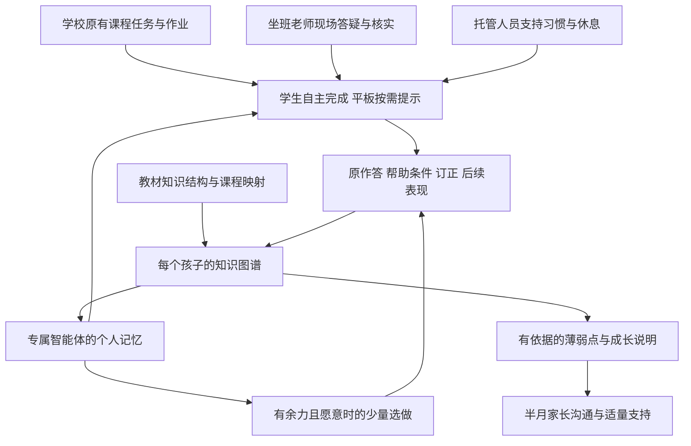

# 学伴产品总纲与开发入口

版本：v3.1，2026-10-16，托管自主学习定位修订。核心边界见 [项目定位](../POSITIONING.md)，研发验收状态见 08 与根目录验证记录。

## 1 产品主张

**让孩子更自主地完成学校学习，让家长更准确地了解孩子。**

学伴服务托管班。孩子在平板 AI 学伴的辅助下完成学校已经布置的课程任务、作业与订正；遇到问题由坐班老师在能力范围内答疑。托管人员帮助任务启动、自检、休息和日常习惯。系统把这些真实过程整理成证据，逐步完善每个孩子的知识图谱，并向家长准确说明薄弱点及变化。

知识图谱与专属智能体仍是系统核心。图谱帮助理解孩子当前的知识状态；智能体接续历史并在需要时给出适量支持。产品不为托管班建立独立授课课程，不以填满图谱、增加练习或提前学完内容作为目标。

## 2 每个孩子拥有的个人记录

| 个人资产 | 内容 | 作用 |
|---|---|---|
| 学校任务记录 | 原作业、学校要求、完成与求助情况、必要的进度信息 | 帮孩子完成自己的任务，区分学校要求与系统选做 |
| 个人知识图谱 | 已观察知识点、错误事实、待核实错因、已验证范围与未知项 | 准确定位需要关注的地方，避免过度判断 |
| 专属 AI 学伴 | 独立身份、当前任务、经确认的记忆和帮助历史 | 提示接得上上一次，逐步支持自主思考 |
| 成长档案 | 订正、独立完成、减少提示、自然后续作业中的表现 | 记录真实变化和反复，不要求每期必须显著进步 |
| 托管支持记录 | 坐班答疑、任务启动、自检、休息、提醒与反馈 | 帮助工作人员交接，观察孩子是否逐步减少依赖 |
| 家长学习说明 | 重点发现、来源、范围、不确定项和适量建议 | 让家长看懂孩子，不把报告变成额外作业清单 |

“专属”指独立的个人状态、记忆与授权，不要求给每个孩子训练一个基础模型。模型是否私有部署单独评估。

## 3 产品结构

学习过程产生数据，数据帮助理解孩子。未知知识点继续保持未知，不能反过来要求孩子为了系统的数据完整性做更多题。

## 4 六项学习能力如何使用

| 能力 | 托管场景中的使用方式 |
|---|---|
| 纠错与订正 | 围绕学校作业定位问题，分层提示，必要时请坐班老师答疑 |
| 知识点分析 | 将作业问题映射到知识点，分开记录错误事实和待核实原因 |
| 举一反三 | 优先观察后续学校同类题；额外变式仅在必要、有余力且愿意时提供 |
| 预习 | 协助学校已经布置的预习；系统建议的额外预习作为可选支持 |
| 错题整理与半月回看 | 自动整理已有作业和答疑记录；小测是可选核实，不是固定负担 |
| 家长汇报 | 固定半月汇总，说明薄弱点来源、样本范围、帮助条件、变化和未知项 |

额外任务预算默认 0。学校任务完成、孩子愿意、有余力三个条件成立后，才提出少量选做建议；允许随时跳过或暂停，不产生扣分、欠账和次日追补。休息始终优先于额外任务。

## 5 要建设的竞争优势

**日常学习就能形成连续记录。** 从托管班已发生的学校作业和答疑中积累证据，让图谱逐步完善，减少为测量而额外增加的任务。

**家长得到可溯源的薄弱点说明。** 报告不仅展示标签，还说明具体题目、出现频次与分母、是否用过帮助、判断范围以及尚未确定的部分。一次错误和持续薄弱明确区分。

**AI 了解过去，坐班老师了解现场。** 智能体接续历史；老师回答当前作业问题并核实证据；托管人员了解孩子是否需要休息或执行支持。三者共同减少重复解释与无效催促。

**支持逐步自主。** 观察孩子能否自己启动、尝试、自检和求助，是否减少对答案和提醒的依赖。完成自己的学校任务及保持合理负担，比增加平台使用时间更重要。

**家校沟通连续且可信。** 家长可以询问依据和提出异议；坐班老师更正后，图谱与报告同步修正。长期积累的是可靠记录与服务能力，效果仍需试点验证。相关产品与研究见 01、03。

## 6 坐班与平台分工

坐班老师负责能力范围内的作业答疑和证据核实，不承接独立补课方案或授课排课。无把握的问题保持待核实，必要时由负责人联系适当支持，或建议家长与学校老师沟通，不用 AI 编造确定答案。

教官或托管支持人员负责习惯、秩序、休息与任务执行，可以与坐班老师由同一人兼任；五类工作视图不代表必须配置五个人。平台的内容质量人员维护课程映射、内容与评测标准，不等于每个班配置专门教研师资。

## 7 开发与验收起点

完整 V1 包含建档、学校任务与求助、作业证据、个人图谱、专属智能体、适量选做、托管工作台、半月家长汇报、内容质量、权限与更正。首批支持的年级、教材、学科和题型须明确；内容暂未覆盖时显示待核实，不能凭空补齐分析。

第一个可演示里程碑：两名孩子完成不同的学校作业，系统形成不同的图谱与家长关注点；默认没有额外练习；无小测也能发布准确说明数据不足的报告；一次误判更正能更新图谱并阻止旧草稿继续发布。

建议先用模块化后端、关系型主数据、对象存储和模型适配层落实这些规则。学生端适配平板，工作人员采用 Web，家长端适配手机。研发资源与条件化排期见 08；生产认证、持久化、真实模型、OCR 和完整终端仍须实现并验收。
