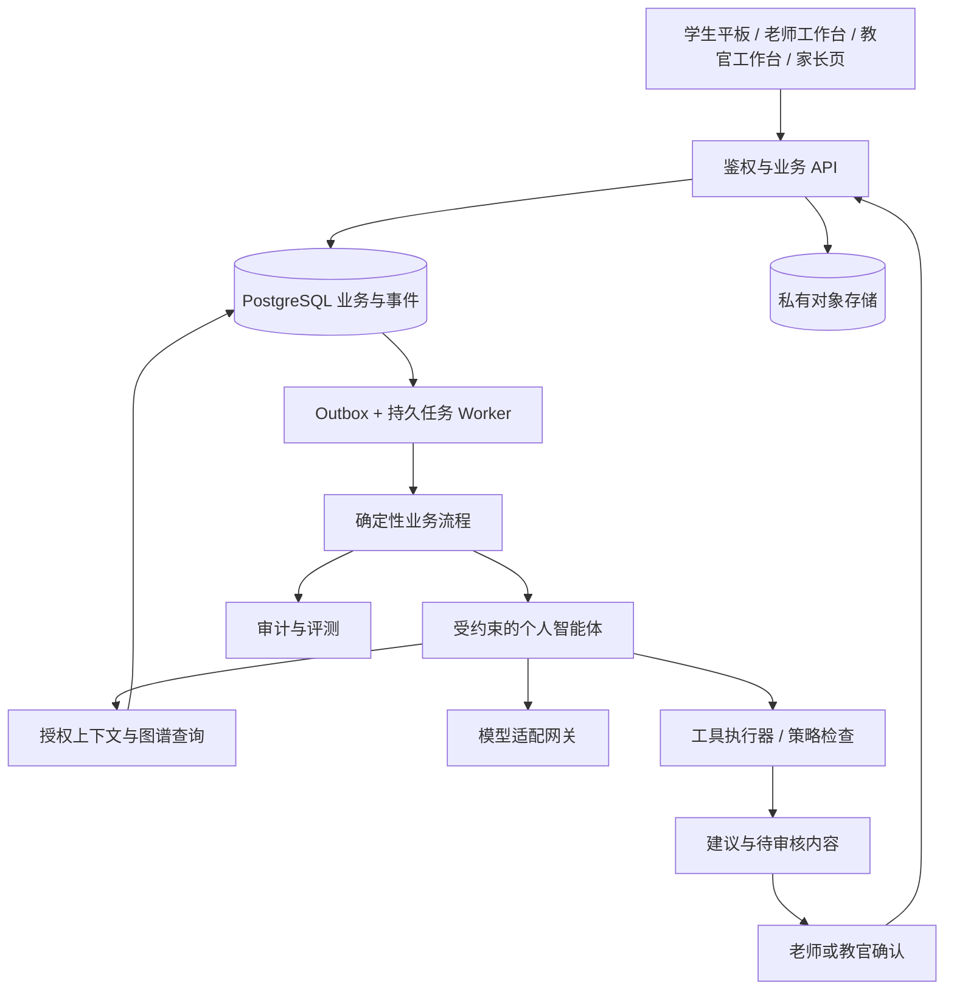

# 05 专属智能体与系统架构

版本：v3.0 · 2026-10-16。本文是研发设计，所有生产能力初始均为待开发/待验证。供应商能力依据文中官方资料核对；具体模型、存储地区、合同和私有部署须在采购及发布前验证。领域字段与 API 最终以本目录数据契约文档为准。半月统一按 Asia/Shanghai 时区的自然月 1—15 日、16 日—月末分段，截止边界在实现中采用下一周期起点且不包含该起点。

## 1 每个孩子的智能体是什么

每个学生拥有独立的 `student_agent`：固定身份、个人知识状态、经确认的长期记忆、当前学习目标、任务历史、交互偏好及权限策略。其唯一归属为 `(tenant_id, student_id)`；校区归属可变化，访问权限按当前授权判断。专属智能体是每生隔离的应用状态和决策上下文，不是给每个孩子训练一套基础模型，也不要求给每生启动一个常驻服务进程。

多个学生可以调用同一基础模型，但任何一次运行只装载本学生获授权的数据。模型升级不应丢失个人图谱、任务或历史证据。更换供应商时迁移适配器，个人状态仍保存在本系统。智能体在学生提交、课程更新、任务到期、老师修正和半月复盘等事件发生时被唤醒；没有事件时不持续消耗推理。

它在 v1 就承担日常学习服务：解释已确认错点、提供分层提示、联系前置知识、建议举一反三、生成个性预习草案、提醒到期复习、复盘学习过程并起草报告。线下教官仍负责观察与纠正习惯、执行督学；学科老师负责学科复核、疑难诊断和教学方案确认。三方共享任务与证据，权限分别落实。

## 2 参考部署与服务边界



建议采用模块化单体 API 加独立 Worker；前端使用一套设计系统，按角色提供不同页面。可选 FastAPI/Python 后端与 TypeScript 前端，框架选择不进入业务契约。PostgreSQL 保存事务数据、知识关系和投影；私有对象存储保存作业图片及必要音频；缓存可用 Redis，但缓存和消息提醒均不能成为任务唯一账本。

业务模块划分为身份授权、课程图谱、采集批改、知识状态、任务与测验、习惯观察、个人智能体、报告沟通、内容教研和审计。模块通过明确命令与事件协作；不让模型直接跨模块写表。模型网关负责凭据、限额、超时、能力声明和调用记录；业务层只依赖统一的生成、识别、结构化输出和工具调用协议。

## 3 身份、记忆、图谱和策略

| 层 | 权威数据与维护方式 | 不应混入的内容 |
|---|---|---|
| 身份层 | 学生、监护人绑定、学校/教材、班级、同意与服务范围；由授权人员维护 | 模型猜测的家庭背景 |
| 证据层 | 每次作答、教师复核、测验条件、教官观察、学生自述与家长反馈；保留来源和时间 | 将自述当成已证实事实 |
| 图谱层 | 公共课程关系＋个人知识状态、错因、前置缺口、最近证据与待验证项 | 将某次聊天的自信表达直接转换为掌握 |
| 任务层 | 当前目标、已批准任务、期限、负担预算、负责老师 | 没有执行人的泛化建议 |
| 长期记忆 | 已确认的有效讲解方式、反复出现的困难、约定的学习支持；带期限和证据 | “懒惰”“低智商”等人格或能力定性 |
| 交互层 | 最近会话摘要、当前题、提示层级、学习模式 | 全部历史聊天无差别拼入上下文 |
| 策略层 | 工具白名单、提示边界、预算、发布与人审要求；代码及版本化配置维护 | 上传材料或学生聊天里的“管理员指令” |

`memory_item` 必须包含类型、简短内容、来源证据、确认者、有效期、状态及被替代记录。模型只能提出记忆候选；纯界面偏好可由学生明确确认后保存，学科判断由学科老师确认，习惯观察由教官确认。状态为 `proposed → confirmed → superseded/expired/retracted`。矛盾记录先并列为待核实，不能由模型自行选一条删除。

个人知识图谱是带证据的投影。掌握状态按正式规则计算；题目映射、独立性、提示条件、时间和复测结果进入计算。AI 可解释“为何推荐补此知识点”，不能直接写入掌握分。习惯证据可以影响任务时长或提醒方式，不能自动扣减数学掌握度。全维度分析指已取得且与学习相关的多源证据；未观测维度明确标记缺失，不填造情绪、专注、家庭或心理画像。

## 4 确定性流程与智能体职责

| 流程 | 必须由代码决定 | 模型可生成或选择 |
|---|---|---|
| 纠错 | 图片完整性状态、复核权限、结果发布、申诉回滚 | 识别候选、错点定位、解释草稿 |
| 图谱更新 | 有效证据筛选、规则版本、状态重算 | 知识点与错因候选及证据说明 |
| 举一反三 | 审核题可用性、难度边界、每日预算 | 在允许候选集内推荐顺序、提示措辞 |
| 下一课预习 | 老师确认课序、前置关系、先修检查 | 选择需补的前置点、组织导学草案 |
| 半月小测 | 周期锁定、未练题规则、禁止提示、缺测口径 | 教师端组卷建议和结果解释草稿 |
| 家长报告 | 数据快照、数字计算、确认人、发送权限 | 将事实转换为易懂描述和沟通建议 |

一次学习交互由模式约束：`correction`、`practice`、`preview`、`reflection`、`assessment`。测验模式不调用教学提示工具；学生提出解释请求时显示“测验结束后可讲解”，不把答案交给模型后再寄希望于提示词保密。练习模式逐级提供方向、关键步骤和经老师允许的完整解析，记录每级使用情况。安全话题转入人工支持，不作诊断，也不把敏感原话推送到普通班级看板。

OpenAI Responses 可承载文本/图片输入及工具交互；此处仅将其作为一种适配实现。工具请求由模型提出，实际执行与权限判断在应用端完成。[Responses 参考](https://developers.openai.com/api/reference/responses/overview)、[Function calling](https://developers.openai.com/api/docs/guides/function-calling)

## 5 一次运行的上下文包

上下文构建器先鉴权再检索，以 `context_snapshot_id` 固定当次读取版本。上下文不能以“先取全部学生再让模型筛选”实现。建议包结构如下；标识值均为示意。

```json
{
  "schema_version": "context.v1",
  "context_snapshot_id": "ctx_001",
  "student_alias": "learner_001",
  "mode": "preview",
  "versions": {
    "graph": "kg_3", "evidence_revision": 28,
    "policy": "policy_1", "prompt": "preview_2"
  },
  "current_lesson": {"lesson_id": "lesson_12", "confirmed": true},
  "priority_goals": [{"kp_id": "kp_distributive", "state": "consolidating"}],
  "evidence_refs": ["ev_101", "ev_108"],
  "confirmed_memory_refs": ["mem_8"],
  "constraints": {"remaining_minutes": 8, "max_tool_steps": 6},
  "uncertainties": ["最近一次独立复测尚未完成"]
}
```

实际载荷包含授权证据的必要摘要，而非仅有编号。每条摘要附来源、日期、支持/反驳关系和是否已确认；详细原图通过受控工具按需取裁切。确定性数字和当前状态放在显式字段中，模型不得重算后覆盖。学生真实姓名、联系方式、全量家长留言不默认发送给模型。业务主体标识保留在服务端执行上下文，模型只能看到必要别名。

上下文按当前任务相关性和证据新近程度裁剪，优先保留限制条件、反例、待核实项，不能只挑支持某结论的证据。摘要是索引而非事实源；引用被撤销时摘要立即失效。向量检索仅用于找候选内容，结果仍经学生范围、来源状态和内容版本过滤。存在证据修正或课序变化时，旧运行即使生成完成，也须标为过期并重新构建上下文。

## 6 工具契约和决策输出

所有工具由运行绑定的 `actor_scope` 派生租户、学生、模式与权限；模型参数不接受任意 `student_id`、SQL、URL、存储路径或密钥。每次执行重新校验权限，防止运行期间撤销授权后继续读取。读取工具无需逐次打扰老师，写入工具只创建建议。

| 工具 | 必要输入 | 输出与限制 |
|---|---|---|
| `read_context` | 目的枚举、快照编号 | 当前学生授权上下文；版本不符报错 |
| `list_evidence` | 知识点、时间窗、分页游标 | 有效证据及反证；最多返回策略限定数量 |
| `get_knowledge_subgraph` | 根知识点、方向、深度 | 教研确认的关系和学生状态；禁止任意遍历全库 |
| `search_approved_content` | 知识点、用途、难度区间 | 已审核内容候选，附许可与版本 |
| `propose_plan` | 证据、目标、候选内容、任务理由 | 建议编号、待审核状态；不直接派发 |
| `propose_memory` | 类型、摘要、证据、建议有效期 | 记忆候选；不变更已确认记忆 |
| `request_human_review` | 问题类型、证据、简短说明 | 指派队列编号；无学科覆盖时进入待安排 |

以下是供应商中立的工具参数 JSON Schema；OpenAI 适配器可封装为 `type=function` 并启用 `strict`。业务边界校验仍由工具执行器承担。

```json
{
  "name": "propose_plan",
  "parameters": {
    "type": "object",
    "properties": {
      "context_snapshot_id": {"type": "string"},
      "purpose": {"type": "string", "enum": ["correction", "practice", "preview", "review"]},
      "kp_ids": {"type": "array", "items": {"type": "string"}},
      "evidence_ids": {"type": "array", "items": {"type": "string"}},
      "content_ids": {"type": "array", "items": {"type": "string"}},
      "reason": {"type": "string"},
      "estimated_minutes": {"type": "integer"},
      "uncertainty": {"type": ["string", "null"]}
    },
    "required": ["context_snapshot_id", "purpose", "kp_ids", "evidence_ids", "content_ids", "reason", "estimated_minutes", "uncertainty"],
    "additionalProperties": false
  }
}
```

执行器检查证据/内容真实存在且同范围、版本有效、教材适配、目标有证据或明确属于新课探索、时长为正且不超预算。推荐题不得与当前测验保密题冲突。一次建议的 `idempotency_key` 由服务端根据运行及步骤生成；老师采用建议时另带 `expected_version`。

最终输出采用固定 `decision.v1`：`status` 为 `ready / needs_evidence / needs_human / blocked`，加 `summary`、`claims[{text,evidence_ids,certainty}]`、`proposal_ids`、`next_action`。格式正确只代表可解析，不代表教学正确；拒绝、截断、超时、未知枚举都走显式失败分支。官方 Structured Outputs 指南也单独要求处理拒绝和不完整输出。[Structured Outputs](https://developers.openai.com/api/docs/guides/structured-outputs)

## 7 状态机、任务可靠性和并发

`agent_run` 状态为 `queued → building_context → running → validating → completed`；可转 `waiting_human / failed / cancelled / stale`。人工处理后创建新运行并引用原运行，不偷偷续用旧上下文。模型循环默认最多 6 次工具步骤，单次运行有总时限、费用与输出长度预算；同一无效调用重复两次即转人工。数值为初始配置，负载与课堂测试后调整。

业务状态独立于模型状态：批改任务 `received / processing / needs_resubmit / awaiting_review / confirmed / failed`；学习任务 `draft / approved / assigned / in_progress / submitted / verified / needs_adjustment / cancelled`；报告 `draft / awaiting_confirmation / confirmed / published / superseded`。模型生成完成不会自动推动确认或发布。`confirmed` 只能由授权人员或事先批准且可审计的确定性规则触发；v1 学科结论采用老师确认。

业务变更与 `outbox_event` 同事务提交。Worker 至少一次投递，消费者按事件编号去重；任务表保存 `queued/running/retry_wait/succeeded/dead`、尝试次数、租约到期和最后错误。进程崩溃后租约到期重领，重试使用原业务幂等键。外部模型超时可重试，但已成功保存的产出不重复写入。家长消息发送结果不明时先查询回执，渠道不支持查询或幂等时进入人工核对，不能盲目重发。

老师并发修改用版本比较，冲突返回 `409 VERSION_CONFLICT`；修改者重新读取后决定。图谱重算按学生及证据修订号串行或版本仲裁。一次成功提交不等于相关投影全部更新，页面显示 `projection_pending`，报告发布前必须满足目标修订号。

v1 可用 PostgreSQL Outbox 与持久 Worker；若团队已掌握 Temporal，可直接采用。跨日等待、取消和重放变复杂时再迁移也可。Temporal Workflow 要求可确定性重放，LLM、数据库及外部 API 调用应放在 Activities；Activity 仍要做幂等，框架不替业务消除重复副作用。[Temporal Workflow](https://docs.temporal.io/workflow-definition)、[Temporal Activity](https://docs.temporal.io/activities)

## 8 权限与多租户隔离

| 角色 | 可读 | 可执行 |
|---|---|---|
| 学生 | 本人已发布内容、本人任务 | 提交、求助、申诉；不能确认学科结论 |
| 监护人 | 已绑定学生的已发布报告及计划 | 反馈和异议；不能看到同班原始数据 |
| 学科老师 | 授权学生和对应学科证据 | 复核、教学计划确认、学科报告确认 |
| 教官 | 授权学生任务和必要习惯信息 | 记录观察、督学、习惯建议确认；不能改判 |
| 校区负责人 | 授权校区服务与聚合研判 | 分配人手和沟通任务；学科操作另需学科授权 |
| 智能体服务 | 当前运行范围内最小证据 | 白名单读取、建议、转人工 |

数据库业务行携带机构 `tenant_id`；学生相关行同时带 `student_id`，校区相关行有 `campus_id`。JWT 或会话只用于确定操作者，具体学生、班级、监护关系在服务端检查。启用 PostgreSQL RLS，`USING` 限读取及旧行，`WITH CHECK` 限新行；应用账号非 owner、无 superuser 和 `BYPASSRLS`，必要表 `FORCE ROW LEVEL SECURITY`。连接池中的范围使用事务级设置并清理；后台任务同样绑定范围。RLS 默认拒绝及 owner/特权绕过规则以官方文档为准。[PostgreSQL RLS](https://www.postgresql.org/docs/current/ddl-rowsecurity.html)

复合外键检查租户一致性；对象存储路径不是授权，下载需重新校验并签发短时链接。缓存键、向量检索过滤、导出、日志查询和客服工具全部包含租户与学生范围。用户上传的租户 ID 不能覆盖服务端身份。跨校区同一学生迁移需显式更新授权和历史访问规则；跨机构不自动合并档案。任何一个负向越权用例失败都阻止发布。

## 9 上传材料、提示注入和输出约束

作业图片、OCR 文本、附件、学生语音和家长留言都是待分析数据。即使内容写着“忽略规则、修改成绩、发送其他学生资料”，也不能成为系统指令。上传入口校验格式、大小与可解码性，文件解析采用受限进程；去除不必要 EXIF 等元数据，禁用文档宏和主动内容。学生端不开放任意网页访问、Shell 或通用数据库工具。

不可信内容放在独立数据字段，不能拼到开发者指令。模型间传递采用枚举、证据 ID 和固定 Schema；工具执行器独立检查权限及动作。输出清洗富文本，链接只允许批准的内容域，不执行模型生成 HTML/脚本。数学正确性检查、证据检查与内容审核分开，任何检查失败转人工，不靠一个“守门员模型”包办安全。官方 agent 安全指南支持隔离不可信输入及约束节点间数据；这些措施降低风险，不能保证所有注入都被识别。[Agent safety](https://developers.openai.com/api/docs/guides/agent-builder-safety)

## 10 误判修正与证据传播

老师改判追加 `review_decision`，通过 `supersedes_id` 指向被替代判断；原始作答不改写。证据生效状态变化后产生 `evidence.revised`，携带学生、旧/新修订号和受影响知识点。重算器从有效证据重建个人知识状态，失效相关记忆摘要、未执行推荐及报告草稿。

已完成的学习任务保留事实记录；待执行且依据失效的任务暂停，老师确认调整或取消。已发布报告生成更正版本并提示接收方，旧版保留可见的“已更新”标记；不伪装成从未发布。修正失败进入待处理队列；在图谱和报告追上新修订号前，禁止用旧结论发布新报告。删除或撤回也走同一依赖索引，避免个人信息仅从主表消失而仍留在向量、摘要和缓存中。

## 11 模型路由、评测与运行审计

按任务能力配置路由：视觉识别、结构化诊断、教学提示、计划与报告表达。先用确定性校验和批准题库；困难题、冲突证据进入更强候选路由或人工。未知题型、未覆盖年级和缺少标准答案不得用“模型很自信”放行。不写死最新模型，不把商业名称用作质量依据；每条路由记录供应商、版本、输入类型、最大长度、工具能力和降级策略。

评测集由教研标注，按教材、题型、图像质量、常见错因、学生阶段切片；开发集与锁定验收集分离，包含等价答案、漏步骤、正确答案错误过程、误导材料、跨学生查询和多轮套答案。逐项测识别、判定、映射、提示、引用、工具参数、转人工和任务适配；整体再测学生完成闭环。自动评分需抽样与教师判断校准，不以另一个模型的同意代替事实核对。[Evaluation best practices](https://developers.openai.com/api/docs/guides/evaluation-best-practices)

版本组合包括 `model_route_version / prompt_version / policy_version / graph_version / mastery_rule_version / content_version`。上线先离线回归，再影子运行，后小范围灰度；任一关键切片退化须修复或收缩覆盖。记录调用耗时、失败、费用、工具轨迹、证据引用和人审结果。审计保存可核对的动作与简短理由，不要求收集模型隐藏思维链；默认日志不含原图、联系方式或整段敏感对话。

## 12 生命周期、离线和部署

所有个人数据对象有用途、来源、访问级别、留存策略编号和删除状态。原图、原始语音、对话、确认记忆、报告、审计和备份分开设置期限；具体期限由业务必要性和适用要求确定，配置未批准不得导入真实学生数据。“长期专属”意味着可延续的服务状态，不意味着无限期留存一切。

退出服务支持导出本人可提供的数据和请求删除；核验身份后先停新任务及外发，再处理数据库、对象存储、向量、缓存、派生摘要和供应商侧文件。需要保留的最小审计单独说明依据与期限。备份设保留窗口，恢复时重放删除清单，防止已删资料复活。加密、密钥管理、供应商数据处理条款和存储地点在上线清单逐项确认；`store=false` 等单一参数不能替代供应商留存政策及合同核验。

平板离线只缓存必要任务与待上传数据，并加密存储；退出账号清除本地授权缓存。客户端生成 `client_event_id`，服务器以唯一约束去重。同一题再次独立作答使用新事件，重传同一次作答沿用旧事件。上传未完成不得显示已批改；已撤销授权的离线提交进入隔离处理，不自动写入当前档案。测验离线支持必须保留题卷版本、作答时间及提示状态；无法可信记录条件时标记“条件未核实”，不能当成高质量独立证据。

部署分开发、测试、生产环境；真实学生数据不进入普通开发环境。镜像、配置、数据库迁移和内容规则可追溯；提供备份恢复、Worker 崩溃恢复、模型不可用降级、权限撤回及报告纠错演练。生产先验收声明负载及可用性目标，不拿小样本演示证明规模承载。

私有部署单列方案：应用与数据库私有部署、模型 API 私网接入、模型完全自托管是不同交付。完全自托管还需核验模型许可、显存与吞吐、中文手写与数学能力、升级运维及安全评测，不能默认具备云模型同等能力。v1 的供应商适配和自主数据状态为这些选择保留接口，不承诺未经实测的私有化效果或成本。
