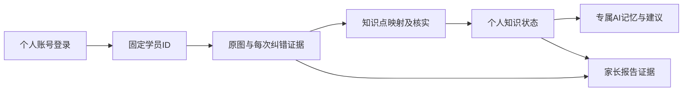

# 学员账号与长期学习档案

2026-10-17：产品身份入口统一为个人账号密码。一名学员对应一个固定学员ID；同一账号可在网页和后续App登录，学习记录由服务端连续保存。原配对码是工程联调入口，不是学员账号方案。

## 业务对象与归属

| 对象 | 用途 | 生命周期 |
|---|---|---|
| 登录账号 | 用户名、密码哈希、停用与初始密码状态 | 管理员开户；密码可重置，不重建学生 |
| 学员身份 `student_id` | 孩子在系统内的稳定身份 | 长期固定，不使用用户名、设备号或登录会话替代 |
| 授权与校区 | 限定本人作业、工作人员可处理的学员及管理员可管理的校区 | 显式授予与撤回，不能通过猜ID扩大权限 |
| 登录会话 | 当前设备的登录凭证与有效期 | 退出、改密、管理员重置后可失效；不删除学员档案 |
| 作业证据 | 原图、题目、每次作答、提示使用、订正父链、判定及更正 | 归属于学员ID，供后续知识分析引用 |

新增账号表绑定已有Principal和Student，不复制原学员。既有 `tablet_actor → tablet_demo` 联调身份可原位绑定用户名，保留已有 Android/Web 作业与图片。管理员账号与学生账号分开，管理员管理校区需显式校区授权；学生不会看到切换其他学员的入口。

## 实际产品流程

1. 托管班管理员登录，在“学员账号”页选择被授权的校区，输入学生姓名、用户名及临时密码，创建账号。
2. 学员用自己的用户名和临时密码登录，先设置自己的密码，再进入本人作业。初始密码未更换时，服务端拒绝作业访问，不仅依赖前端隐藏。
3. 日常直接账号密码登录。退出后换另一名孩子登录，后端和浏览器草稿均按身份隔离。
4. 忘记密码由管理员重置；旧登录会话撤销，学员用新临时密码登录并更换。原作业、订正、以后产生的知识状态与智能体资料仍归属于同一个学员。
5. 后续App使用相同登录API和学员ID，不以安装、换平板、升级或再次登录为理由新建学生。

用户名是登录标识，页面显示学生姓名。个人账号默认只绑定一个学员。学生不能自行指定他人 `student_id`，也不能通过前端修改角色变为管理员。创建账号遇到网络未知结果，先核对用户名的已有记录；重置未确认时不显示“已成功”。密码只在提交过程中使用，不进入作业幂等日志或浏览器持久存储。

## 账号API与运行

业务API由后端实际 OpenAPI 描述，账号接口与已有纠错Schema分离；纠错数据格式无需因为登录方式变化而改写。

| 操作 | 接口 |
|---|---|
| 账号登录 | `POST /v1/auth/login` |
| 当前账号状态 | `GET /v1/auth/account` |
| 修改密码 | `POST /v1/auth/change-password` |
| 当前会话退出 | `POST /v1/auth/logout` |
| 管理员读取账号及可管理校区 | `GET /v1/admin/student-accounts` |
| 管理员创建学员账号 | `POST /v1/admin/student-accounts` |
| 管理员重置密码 | `POST /v1/admin/student-accounts/{student_id}/reset-password` |

密码采用随机盐和scrypt保存，遵循 [OWASP密码存储建议](https://cheatsheetseries.owasp.org/cheatsheets/Password_Storage_Cheat_Sheet.html)；不是明文或可逆加密。登录失败限制、初始改密与会话撤销由服务端执行。首次改密解决临时密码交付问题，不要求孩子每次登录改密。线上部署仍需HTTPS、正式运营身份和部署级限流；本机回环开发入口不会自动对外开放。

管理员首次初始化必须走受控CLI，创建页面本身没有开放管理员注册。CLI通过0600私有文件读取密码，不使用命令行明文参数；具体本机启动见 [WEB_LOCAL_RUN](WEB_LOCAL_RUN.md)。

## 本轮完整网页的图谱、专属 AI 与报告衔接

账号、学员归属、纠错证据及下列学习层已有工程实现，最新状态见 [VALIDATION](../VALIDATION.md) 与 [LEARNING_LAYER](LEARNING_LAYER.md)。这些能力全部纳入本轮网页收口与验收；下表列出集成顺序和数据约束，实际缺口按 [完整网页路线](WEB_ROADMAP.md) 与任务表推进。

| 阶段 | 交付内容 | 数据与验收约束 |
|---|---|---|
| 学员档案与证据时间线 | 年级、教材版本、学校进度；逐次原作答、订正、帮助与复核回看 | 固定学员ID；年级变化不改写旧作业教材信息；已有作业仍可追溯 |
| 知识点映射 | 题目步骤映射到审核过的教材知识点 | 保存图谱版本、来源题目/作答和映射置信范围；多空漏识别先核实 |
| 个人知识图谱 | 以 `(tenant_id, student_id, knowledge_id)` 保存状态与证据引用 | 未核实错误不变成“薄弱”；看提示后的订正不冒充独立掌握；老师改判后能重算 |
| 专属AI学习记录 | 每名学员独立的目标、有效记忆、当前困难与建议 | 所有记忆可回指证据，隔离读取；错误证据撤销后使依赖记忆失效 |
| 家长汇报 | 汇总学习进步、具体困难及托管班支持 | 说明证据范围和帮助条件，不因记录不足增加孩子负担 |

专属AI体现为每名学员独立、持续、可追溯的数据与记忆空间，可共用高质量基础模型。不会给每次登录临时创建一个“新孩子”或丢失以往记录。详细图谱规则继续沿用 [个人知识图谱与成长证据](../blueprint-v3/02-个人知识图谱与成长证据.md) 和 [专属智能体架构](../blueprint-v3/05-专属智能体与系统架构.md)。

## 必须验证的身份连续性

- 现有学员绑定账号后，旧作业ID、图片ID和订正关系保持不变。
- 同一账号重新登录、换浏览器后读取同一学生历史；其他学员读取被拒绝。
- 管理员重置密码后旧会话失效，密码不会用于重新分配学生或清空学习记录。
- 停用账号不能取得新会话；撤销校区管理授权后不能再创建或重置该校区账号。
- 初次密码、请求正文、模型密钥不进入Git、截图、运行日志或浏览器本地草稿。
